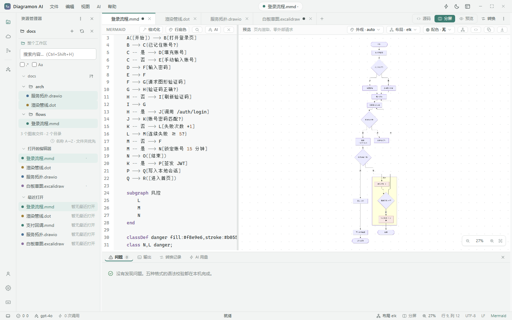
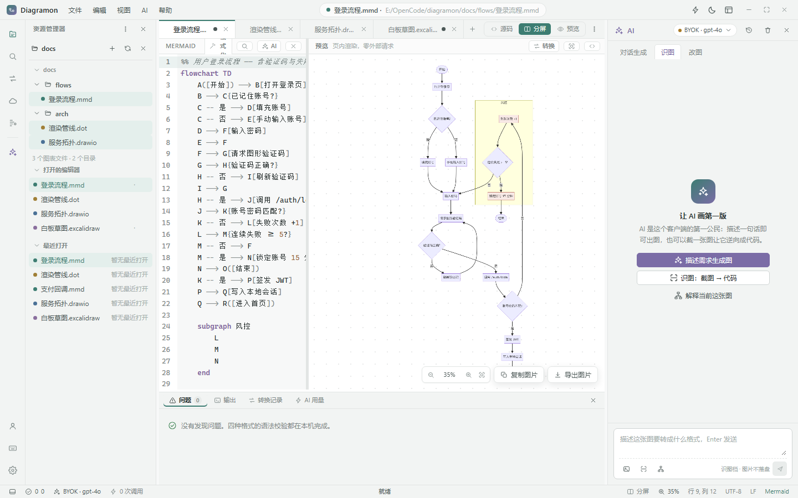
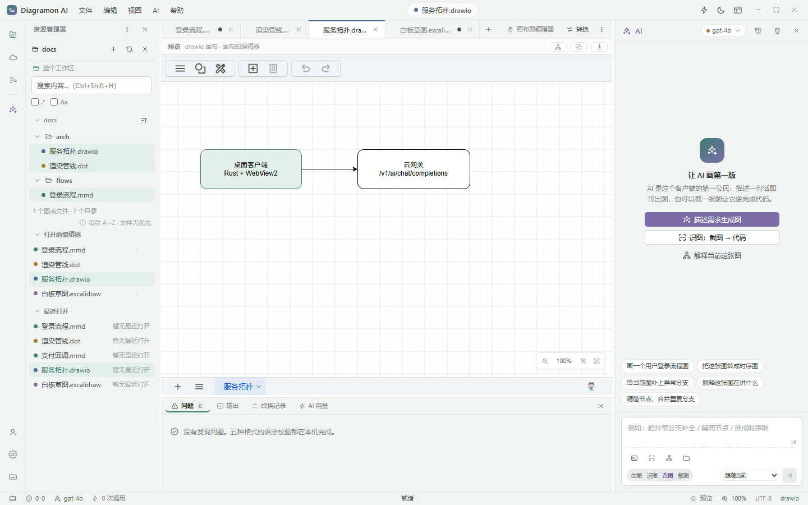
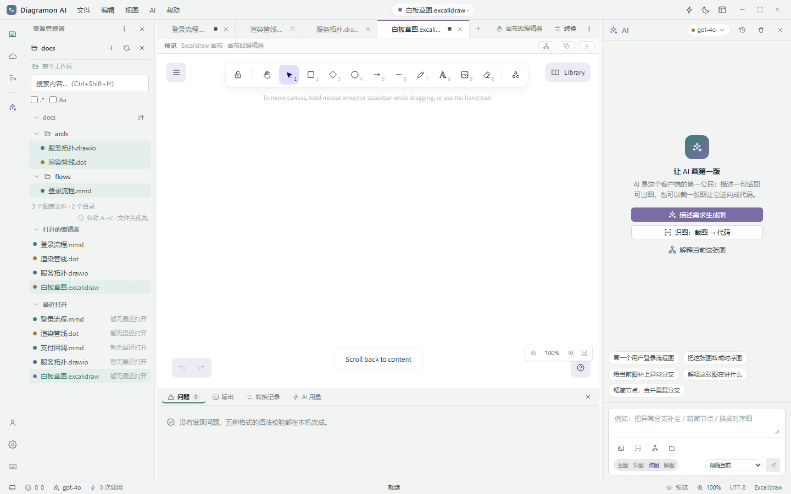
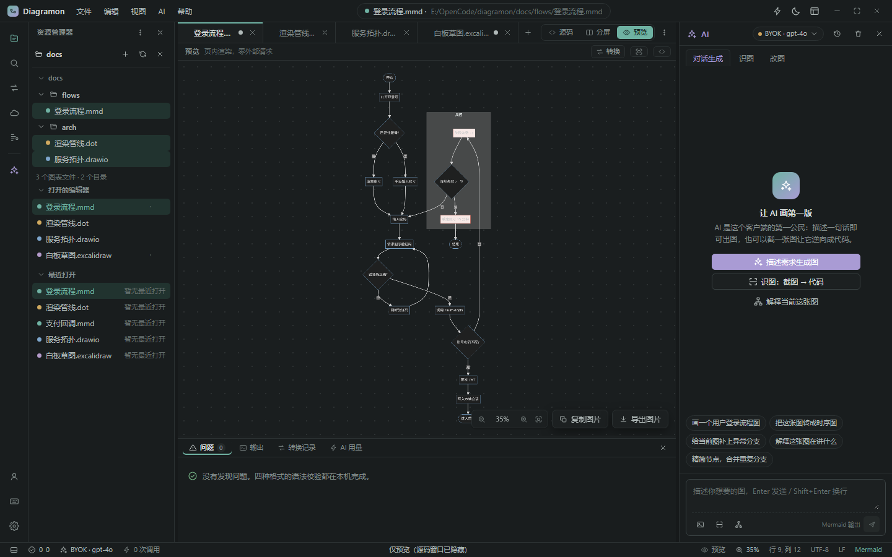
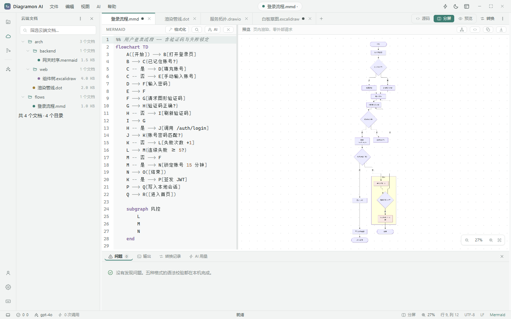
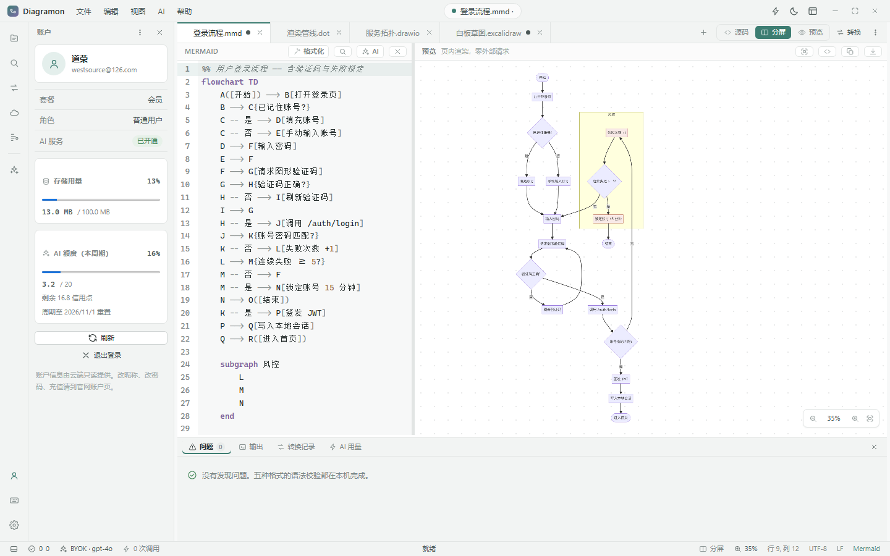
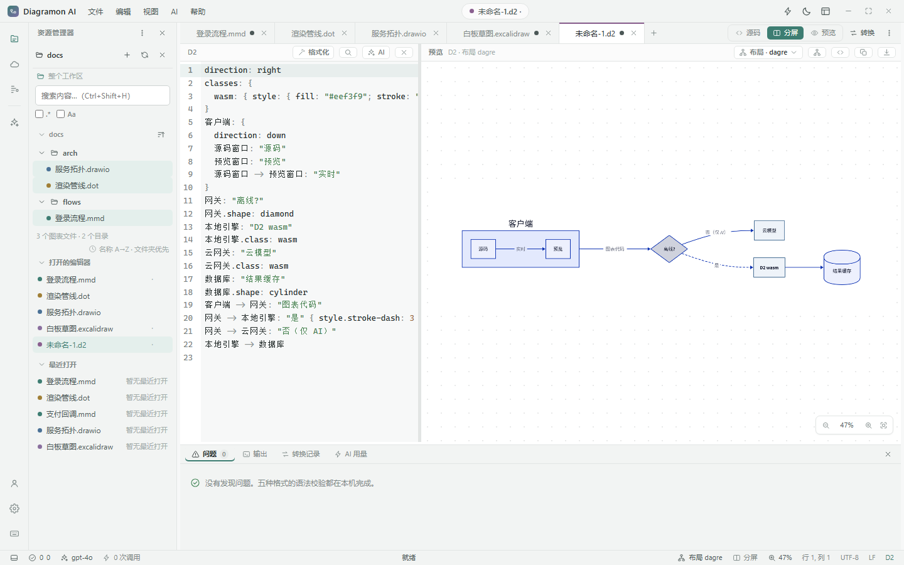

# Diagramon - Multi-format Diagram Editor

[中文文档](README.zh-CN.md)

A **local-first** multi-format diagram editor. **Mermaid** (`.mmd` / `.mermaid`), **Graphviz DOT**
(`.dot` / `.gv`), **D2** (`.d2`), **drawio** (`.drawio`) and **Excalidraw** (`.excalidraw`) can all be
edited with live preview. AI is a first-class citizen: bring your own key (BYOK) or use the membership
cloud gateway, including **image recognition** (picture → diagram code).

**Rendering, syntax checking and format conversion all happen on this machine**: Mermaid and Graphviz
run on engines bundled in the package (WASM / packaged JS), D2 runs on its official wasm build shipped
with the app, and drawio and Excalidraw run on their own runtimes — **no subprocess is ever spawned and
no external request is ever made**.
Code or images reach a model only when you actively use AI, and then only the endpoint you chose
(BYOK talks straight to your own provider, membership goes through the Diagramon cloud gateway).

Version **3.8.6** · Official website <https://www.diagramon.com>

## Screenshots

















## Features

### Editing
- **Multi-tab** — several formats side by side in one window; when tabs overflow they scroll into
  view, respond to the wheel for horizontal scrolling and fade at both ends, and `Ctrl+Tab` /
  `Ctrl+PgUp` / `Ctrl+PgDn` cycle through them
- **Syntax checking with inline errors** — only problems that can actually be *proven* (unbalanced
  brackets/quotes/tags, JSON that fails to parse) are reported, never style guesses; the Problems panel
  aggregates every open document and labels each row with its file name and line/column
- **Mermaid engine 10.9.5 → 12.2.0** — picks up every diagram type and syntax improvement upstream added
  since then, with render output aligned to mermaid.live
- **Errors point at the line and column** — the Problems panel prints "line N, column M" and its button
  switches to the source view with the caret pinned to that spot; the offending line gets a red squiggle
  in the editor (gone the moment it is fixed), and the same location — column included — is fed to the AI
  repair loop
- **Outline and current scope** — nodes and the `subgraph` / `cluster` / D2 container tree are derived
  from the body; the status bar shows the enclosing subgraph/cluster/container next to the caret
  position (and nowhere else, so no information is duplicated)
- **Find & replace**, undo/redo, context menu, command palette (`Ctrl+Shift+P` or `F1`)
- **Tab behaves like mainstream editors** — with an empty selection Tab fills spaces to the next tab stop
  **at the caret** (at the line start it still inserts a full 4-space unit), a selection is indented as a
  block and `Shift+Tab` outdents; one key press is still one undo step
- **Large-document guard rail** — past a line/byte threshold the preview asks "render anyway?" instead of
  silently dragging the engine down (the threshold lives in exactly one place, pushed down from Rust)

### Preview and export
- **Three text modes** — source / split / preview (`Ctrl+1/2/3`); the source pane can be hidden entirely
- **One gesture vocabulary for every surface** — wheel to pan, `Shift+wheel` to pan horizontally,
  `Ctrl+wheel` to zoom anchored at the cursor, drag to pan, double-click to fit; `Ctrl+0` / `Ctrl+=` /
  `Ctrl+-` are forwarded by the shell to whichever surface is active
- **"Fit" means content, not page** — fitting uses the diagram's own bounding box in both dimensions and
  centres it (drawio's page frame is deliberately ignored, so cells outside it are no longer clipped),
  clamped to the same 0.2×–30× range as the other surfaces
- **Status-bar zoom readout** — shows the zoom of the *active* view only (each canvas's own readout is
  hidden so two numbers can never disagree on screen)
- **Layout engine picker** — DOT offers `dot` / `neato` / `fdp` / `sfdp` / `twopi` / `circo`, switched
  incrementally without reloading the WASM engine; D2 offers `dagre` / `elk` / `tala`, recompiled for the
  new layout while the engine instance is reused (`tala` is slow — pick it deliberately); Mermaid offers
  `dagre` and ELK, the latter shipping as an offline bundle (`@mermaid-js/layout-elk`) whose failed load
  falls back to dagre instead of breaking the preview. That bundle is a **one-off, permanently resident**
  cost (measured: +7.7 MB JS heap, +16 MB process working set, ~0.5 s to load), so it is only pre-warmed
  in the background **if you have used elk before**; everyone else loads it on the first switch and never
  pays for it otherwise
- **Render options live in the preview top bar** — Mermaid shows two (Look + Layout), DOT / D2 show one
  (Layout) and the canvas formats hide them entirely; the choice is **remembered per file** (close the
  tab or restart the app and reopening that file still uses it) and re-renders immediately (the
  status-bar layout entry stays and reads the same data)
- **Mermaid look modes** — classic / neo / handDrawn, switchable at any time, matching the mermaid.live
  look and feel
- **The D2 engine warms up on demand** — D2's runtime is an 11 MB **offline** wasm build: the first `.d2`
  document waits a few seconds (the UI says "initializing the D2 engine") and later renders take tens of
  milliseconds. Warm-up only happens **if you recently opened a `.d2` file**, so people who don't use D2
  never carry that resident memory around
- **Export** — save an image (PNG, selectable scale) or copy it to the clipboard; text formats go
  `SVG → canvas → PNG` with zero subprocesses. Bitmaps carry **the same background as the preview**
  (opaque, so pasting into a white document never looks blank), and a diagram beyond Chromium's canvas
  limit (2^28 pixels) has its scale reduced with a note in the status bar instead of silently producing
  an empty image
- **Render output is sanitized before it is mounted** — the engine's SVG is stripped of scripts, embedded
  objects and event attributes in an inert container first (a second line of defence behind each engine's
  own escaping), and the shell document ships a CSP that allows no inline script

### Canvas editing (drawio / Excalidraw)
- **The canvas *is* the editor** — rather than hiding controls, the UI says so: neither format offers the
  source/split/preview triple
- **On disk it stays text** — a `.drawio` file is mxfile XML and a `.excalidraw` file is scene JSON; the
  canvas is just a view of it, so what lands on disk stays diffable and version-controllable and reuses
  the same save / save-as / recent-files path
- **Automatic write-back** — canvas edits (including drawio's own autosave) are written back into the tab
  body and raise the dirty flag; saving first asks the canvas for its current body so edits inside the
  autosave debounce window are never lost
- **Undo history survives** — the carrier page stays alive, so switching tabs never destroys it
- **Offline by construction** — a pruned drawio runtime and a locally bundled Excalidraw ship inside the
  installer; zero external requests

### Format conversion (Conversion Center)
- **Directions** — `Mermaid → DOT` / `Mermaid → D2` / `DOT → D2` (implemented in pure Rust),
  `Mermaid → drawio` and `Mermaid → Excalidraw` (handed to each engine's own parser instead of
  reimplementing one), and `D2 → drawio` (D2's own wasm computes the geometry in the page first, then it
  is mapped to mxGraph — **geometry preserved**, and the result stays draggable and editable)
- **Directions that are deliberately not built say why** — D2 is a superset of Mermaid / DOT
  (containers, classes, vars, layers…), so folding it back would mean deciding per feature what to drop;
  the "get out of D2" need is served by `D2 → drawio` instead
- **One-way semantics** — the product opens in a new tab and the original file's bytes never change
- **Lossy conversions say so** — the result carries `notes` listing exactly what did not migrate
  (e.g. `subgraph → cluster` drops styling); the dialog shows them, nothing is dropped silently
- **Unavailable directions are still listed, with a stated reason**, rather than hidden for you to guess
- **The Mermaid details that used to break the output are handled** — edge endpoint markers are honoured
  (`<-->` becomes DOT's `dir=both` / D2's `<->`), markers the target format has no shape for
  (`o--o` / `x--x`) degrade to a plain edge and are recorded in `notes`, names that collide with DOT
  keywords (`EDGE`, `node`) are quoted so graphviz accepts them, and D2's `stroke-width` is rounded and
  clamped to its 0–15 range with the original value recorded in `notes`
- **`Mermaid → Excalidraw` inherits the document's look** — when the source document picked classic /
  neo / handDrawn in the top bar, the converted Excalidraw is rendered with that same look; the
  conversion record states what was inherited and that the layout was re-done with the engine's defaults

### Workspace and files
- **Open a folder** — explorer tree (only extensions this app knows; `.git` / `node_modules` / `target`
  are skipped)
- **Whole-workspace search** (`Ctrl+Shift+H`) — streamed from Rust with line/column, click to jump,
  cancellable
- **File watching** — external changes are picked up automatically; when they collide with unsaved local
  edits you get a banner to choose "use disk version / keep mine" (a state that needs a decision is not a
  toast that disappears on its own)
- **Single instance + file associations** — double-clicking a diagram file opens it in the running window
  instead of starting another process
- **Autosave and crash recovery** — autosave is owned by Rust (a background thread, not a front-end
  timer); unsaved documents have a draft store where one corrupt file cannot take down the others
- **Path guarding** — create/rename/delete inside a workspace always go through root validation and
  reject `..` and absolute paths; "save as / export" uses the system dialog (that is the user's own
  authorization), and can be tightened with "only read and write inside the workspace"

### AI assistant
- **Three tabs** — generate (natural language → diagram code for the current format), vision
  (image → code) and review (ask for changes to the current document)
- **Two kinds of credentials, kept visually separate** — the cloud gateway (membership; the credential is
  the current login token, so you fill in nothing) and local BYOK (OpenAI-compatible / Ollama / custom,
  where you supply the key) are shown as groups, never mixed
- **Two ways into vision** — pick an image file, or **drag out a region of the screen** (freeze-frame plus
  a borderless overlay, so multi-monitor and DPI scaling never come into play); the image is compressed to
  ≤1568px in memory and never written to disk
- **External files work as context too** — use the **folder button** in the row above the AI input
  (multi-select), or drop a file **directly onto the AI panel**: up to 8 files, 256 KiB each (larger
  ones are cut on a character boundary and labelled), UTF-8 text only (binary or other encodings
  report a clear error). Reference files and "current diagram source" are worded separately in the
  prompt, so the model does not treat your reference as the document to rewrite
- **The AI only fixes what the AI wrote** — the render-failure auto-fix fires only while the body is
  still exactly the version the AI applied; syntax errors you introduce yourself are never rewritten
  behind your back (they are still reported in the preview and the problems panel)
- **Usage is labelled with its source** — only tokens the provider actually reports are accumulated;
  anything unreported shows `—` with an explanation, never `0` and never a local estimate
- **It actually remembers the conversation** — previous turns are carried into the next request
  (auto-trimmed, newest turn always kept), so you can keep refining the same diagram across messages
  instead of starting from scratch every time
- **Conversation history, persisted per document** — histories live locally, keyed by document, and
  survive restarts; the History dialog shows real turns, and clearing affects only the current document
  (images are never written to disk)
- **The History dialog has two tabs: "This document" / "All"** — All lists every conversation on this
  machine under three ownerships (document / draft / unlinked), **including conversations in unsaved
  documents**, with search and a "N conversations · M drafts · K unlinked" summary. The row's primary
  action is Open (document) / Restore (draft → its tab) / Restore as a new tab (unlinked); the ⋯ menu
  offers "Show in folder / Export Markdown / Delete", and unlinked conversations older than 30 days can
  be pruned in one click (with confirmation). Drafts and unlinked conversations are **never removed
  automatically**
- **A conversation exists before the file does** — a brand-new document that was never saved keeps its
  conversation in a **draft** store, so it comes back after a restart; the draft moves under the file's
  identity at the moment you save / save-as, so conversations recorded before a rename or move are not
  stranded on the old path
- **Conversations are stored by ownership, not "the active tab"** — switching tabs while an answer is
  streaming no longer loses a turn, and "apply as a new tab" carries the conversation over with the
  diagram it produced; a failed save now says so instead of being ignored
- **The reasoning is visible — and collapsible** — thinking models (GLM / DeepSeek / Qwen family)
  stream their chain of thought above the bubble; it folds away automatically when the turn ends, and a
  click on the summary row (or Enter / Space) opens it again for the full transcript. A turn that
  produced only reasoning says why and keeps it there. The reasoning is **stored with the
  conversation** (it is billed output), so after a restart expanding the block shows the same text
- **File open history** — the welcome page lists 5 recent files and its **More…** button opens the
  complete history (up to 50 entries kept locally, filterable by name or path; click a row to open it —
  a file already in a tab is focused instead). `Ctrl+R` and **File → Open recent → More…** open this
  same window
- **Long-term memory (optional)** — the AI can propose to remember your preferences and terminology
  (colour scheme, default flow direction, naming habits…). Proposals land as **pending** and only take
  effect once you confirm them; you can also edit them by hand, and the whole thing can be switched off
  or cleared — everything stays on this machine
- **Controlled tool loop (experimental)** — when enabled, the AI may "read the document → check grammar
  → validate" before answering, for at most 5 steps. The tools only operate on the in-memory document
  model — they **never touch the filesystem, shell or network**. Enabling it switches to non-streaming
  multi-step calls (no more word-by-word output) and every step counts toward usage — which is why it is
  off by default
- **Auto-fix on render error** — if generated code fails to render locally, the error text goes back to
  the model for one automatic repair (switchable off in settings)
- **Cancellable**, and failures are reported as failures
- **Keys never reach the front end** — they live inside the Rust process only (DPAPI on Windows,
  encrypted per user); the front end only ever sees `has_key` and a mask

### Cloud (Diagramon Cloud)
- **Login tokens go into the credential store** — access and refresh live in Windows DPAPI, and the front
  end only receives an account snapshot and document lists; "signed in" is a statement of fact, not
  something a page can fake
- **Silent token refresh** — an expired access token is exchanged for a new one automatically (honouring
  the server's rotation and reuse-detection rules), so a session renews itself for the lifetime of the
  refresh token and a restart no longer asks you to sign in again
- **Account view** (read-only) — email, display name, plan, role, storage usage, plus **AI entitlement and
  credit balance** (measured in *credits*, deliberately not anchored to any currency)
- **Cloud documents** — folder tree (empty folders included), filter, open; the **save to cloud** dialog
  lets you pick a target folder and create a subfolder
- **Login is a stop on the way, not the destination** — starting from "save to cloud" continues into the
  save dialog once you are signed in
- **Registration is not done in the client** — the footer only offers "register on the website", which
  opens the system browser at the configured service address
- **An empty base_url switches the cloud off entirely**; everything keeps working offline (offline-first
  is the product's baseline)
- **No fake data, ever** — "not configured" means exactly that, "not signed in" means exactly that, and a
  balance is never invented

### Settings, themes and updates
- **Light and dark themes** plus several accent colours; switching only changes one attribute on the root,
  and every colour is read from CSS variables
- **Panel state is remembered** — sidebar / AI / bottom panel visibility and widths, the source-pane
  ratio and recent files are all restored on restart
- **Bilingual UI** — `zh-CN` and `en-US`; both sides carry exactly the same key set (a single missing key
  fails the whole acceptance run)
- **Built-in auto-update** — minisign signature verification; "up to date", "new version available"
  (download → restart) and "error" are three distinct outcomes, and a failed check is never reported as
  "up to date"
- **Close to tray (opt-in)** — turned on in Settings → Appearance, ✕ only hides the window; the tray icon
  brings it back, or quits from its menu. The icon is always present, so you can quit under either setting
- **Default Mermaid look** — a global fallback used when a document has no look of its own (priority:
  document choice > global default > Mermaid's built-in; frontmatter config always wins)
- **The settings panel scrolls** — it used to be clipped wholesale by an outer container (a `max-height`
  that leaked out of the panel), putting everything below the fold out of reach; content taller than the
  panel now scrolls inside it

## Tech Stack

- **Language / framework**: Rust (edition 2021) + Tauri 2; the front end has no framework, **no build
  chain** and no CDN
- **WebView**: the system webview (WebView2 on Windows)
- **Editor**: CodeMirror 6 (bundled into `ui/vendor/` and exposed to the shell — no npm dependency at
  runtime)
- **Rendering engines**: Mermaid (packaged JS) · Graphviz (WASM) · D2 (official wasm build shipped in the
  installer) · drawio (pruned runtime shipped in the installer) · Excalidraw (locally bundled)
- **AI networking**: Rust (reqwest + SSE streaming), credentials in DPAPI
- **Packaging**: NSIS installer; both the rendering runtimes and the front-end `ui/` are bundled as
  resources (the D2 wasm alone is about 11 MB)

### Why there is a custom `dgm` protocol

The shell and the carrier pages (drawio / Excalidraw / graphviz / mermaid / d2) **must be same-origin**:
the canvas ↔ body round trip works by reading and writing `__hostQueue` / `__apply` directly on
`iframe.contentWindow` (the contract's source of truth is the comment block in
`tools/drawio-host/host.html`). Cross-origin makes that impossible and forces a fallback to
"host polling + script injection", which is not reliable on a WebView wrapper layer.

So the whole application is loaded through `dgm`: `http://dgm.localhost/` on Windows and
`dgm://localhost/` elsewhere. `/drawio/`, `/excalidraw/`, `/graphviz/`, `/mermaid/` and `/d2/` are mount
points; everything else resolves into `ui/`. The protocol never serves anything outside its roots: the
path is percent-decoded first, and a backslash, a `..` segment or an absolute/rooted form is refused
(a real traversal hole existed here before 3.5.2; the regression tests live in `crates/assets`).

### Runtime split (in one line)

**Anything that touches machine state belongs to Rust; anything that touches rendering and interaction
belongs to the WebView.**

| Rust | WebView |
|---|---|
| Window / single instance / file associations / updater | All UI chrome, layout state machine, key dispatch |
| File I/O (atomic writes), recent files, settings persistence | CodeMirror 6 editor |
| Syntax checking / outline / scope / conversion (app-core, one source of truth) | in-page rendering: mermaid · wasm-graphviz · D2 (wasm) |
| Workspace-wide search, file watching, autosave timing | drawio / Excalidraw canvas carriers |
| AI networking (streaming), credentials (DPAPI), cloud gateway | AI streaming display, code cards, apply / revert |
| Region screenshot (freeze frame), clipboard PNG, export to disk | Export serialization (SVG / canvas → bytes handed to Rust) |

## Requirements

### Running the packaged build
- Windows 10 / 11 64-bit (WebView2 runtime required; normally pre-installed on Windows 10/11)
- **No** VC++ redistributable: the release build statically links the CRT
- The canvas / rendering runtimes (about 105 MB, including D2's 11 MB wasm) and the front-end `ui/` are
  inside the installer — nothing extra to download

### Development
- A Rust toolchain (this machine uses `stable-x86_64-pc-windows-gnu`)
- Rendering / canvas runtimes are not committed (drawio · excalidraw · graphviz · mermaid · d2, about
  105 MB in total): during development `crates/assets` walks up to find the source tree, but packaging
  requires exporting them first (D2 is fetched automatically by `node tools/fetch-d2.mjs` — see below)

## Development and verification

```bash
cargo run -p diagramon                 # start the client
node tools/dev/check.mjs               # the full acceptance run
node tools/dev/check.mjs --test-only   # Rust unit tests only
node tools/dev/check.mjs --skip-test   # on-device self-test only (build still runs)
python tools/dev/canvas_probe.py       # canvas probe: real drawio load → read back → screenshot
python tools/dev/ui_probe.py           # UI probe: real interaction assertions in the browser prototype
python tools/dev/readme_shots.py       # regenerate the screenshots in screenshots/
node tools/fetch-d2.mjs                # fetch the D2 runtime (auto: npm pack / registry download; skipped if present)
node tools/fetch-assets.mjs            # export the five mount points into assets/ before packaging
```

`check.mjs` always runs in the same order: **kill stale instances → build → Rust unit tests → launch the
client and run the real IPC self-test** (the front end writes `ui/.shots/selftest-report.json` and the
script reads it back line by line). Exit code 0 means all green, 1 means a failure, 2 means infrastructure
trouble (build failed / no report produced); the whole run is kept in `ui/.shots/check.log`.

Running the on-device self-test on its own:

```bash
DIAGRAMON_SELFTEST=1 ./target/debug/diagramon.exe
DIAGRAMON_SELFTEST_REPORT=<absolute path>    # or point the report somewhere else
```

> **Two hard rules**, both learned the hard way: the self-test **must not poll the UI with `setTimeout`** —
> WebView2 throttles timers in background windows to roughly once per second; and **`async` commands must
> return a meaningful value** — the response of an `async` command returning `Result<(), String>` is
> silently dropped and the front end's `await` never settles.

**You can also open the UI in a plain browser**: load `ui/index.html` and, when no Tauri runtime is
detected, it falls back to a built-in **mock backend** (sample documents, fake AI streaming, a fake
problem list) with a `mock mode` badge in the title bar. That is for design review and screenshots — it
never degrades silently.

**Packaging** (PowerShell, from the repository root):

```powershell
node tools/fetch-assets.mjs --verify
$env:TAURI_SIGNING_PRIVATE_KEY = "<path to private key>"
$env:TAURI_SIGNING_PRIVATE_KEY_PASSWORD = "<password>"
npx tauri build --bundles nsis
```

The three artefacts land in `target/release/bundle/nsis/`: the installer, its `.sig` (update signature)
and `latest.json` (update manifest). The full procedure and the paperwork still outstanding are in
[`docs/发布检查单.md`](docs/发布检查单.md).

## Repository layout

```
crates/
  app-ipc/           front-end/back-end contract (single source of truth)
  app-core/          format registry · documents and sessions · lint · outline · scope · conversion · workspace · settings
  assets/            path resolution for the dgm protocol (what makes shell and carriers same-origin)
  ai/                prompts and providers (BYOK streaming chat)
  platform/          platform adapter interfaces (credentials, paths) + a plaintext fallback off Windows
  platform-windows/  DPAPI credential store (encrypted per user)
src-tauri/           Tauri wiring and command layer (windows, protocol registration, commands, events, watcher, capture)
ui/                  front-end shell (no framework, no build chain, no CDN)
  js/                shell · sidebar · panels · tabs · editor · canvas carrier · D2 engine · preview · AI · cloud · dialogs
  vendor/            bundled CodeMirror 6 · mermaid · wasm-graphviz (shipped, no external requests; the D2 runtime lives in `assets/d2/`)
assets/              bundled asset root (exported by tools/fetch-assets.mjs before packaging; not committed)
design/ui-proto/     UI prototypes and design notes (index.html is the design source of truth)
docs/                roadmap and release checklist
tools/               asset fetching (drawio / excalidraw / graphviz / mermaid / d2) · drawio / Excalidraw carrier pages · development acceptance scripts
```

## Keyboard shortcuts

| Shortcut | Action |
|----------|--------|
| `Ctrl+N` | New (with a format it creates directly, without one it opens the format dialog) |
| `Ctrl+O` / `Ctrl+S` / `Ctrl+Shift+S` | Open / save / save as |
| `Ctrl+R` | Recent files |
| `Ctrl+W` / `Ctrl+Q` | Close current tab / quit |
| `Ctrl+F` | Find and replace |
| `Ctrl+Shift+H` | Search the whole workspace |
| `Ctrl+Shift+P` / `F1` | Command palette |
| `Ctrl+I` / `Ctrl+Shift+I` | AI chat / AI image recognition |
| `Ctrl+Shift+C` | Copy the active view as an image |
| `Ctrl+B` / `Ctrl+J` / `Ctrl+Shift+A` | Sidebar / bottom panel / AI panel |
| `Ctrl+Shift+F` | Zen mode (full-screen editing) |
| `Ctrl+1` / `Ctrl+2` / `Ctrl+3` | Source / split / preview |
| `Ctrl+0` / `Ctrl+=` / `Ctrl+-` | Fit to view / zoom in / zoom out |
| `Ctrl+T` | Toggle light and dark theme |
| `Ctrl+Tab` / `Ctrl+PgUp` / `Ctrl+PgDn` | Cycle through tabs |
| `Alt+1` … `Alt+5` | Sidebar views: explorer / search / convert / cloud documents / outline |

Inside the editor: `Ctrl+Z` undo, `Ctrl+Y` redo, `Ctrl+X/C/V/A` cut, copy, paste and select all. When the
preview or a canvas has focus those application-level shortcuts are intercepted by the carrier page and
handed back to the shell, so they keep working.

## About 3.0

3.0 is a from-scratch implementation built against the UI prototypes in `design/ui-proto/`: Rust + Tauri 2
plus the system WebView, with a front end that has no framework and no build chain. The development log,
each step's completion criteria and the dependency graph are in
[`docs/roadmap-dev3.0.md`](docs/roadmap-dev3.0.md).

## License

Apache-2.0, see [`LICENSE`](LICENSE); third-party components and licences are listed in
[`NOTICE`](NOTICE).

## Acknowledgments

This project uses the following open-source projects:

- [Tauri](https://tauri.app/) - desktop application framework (Rust + system WebView)
- [CodeMirror](https://codemirror.net/) - code editor
- [Mermaid](https://mermaid.js.org/) - Mermaid diagram rendering engine
- [Graphviz](https://graphviz.org/) / [@hpcc-js/wasm-graphviz](https://github.com/hpcc-systems/wasm-graphviz) - DOT rendering (WASM)
- [D2](https://d2lang.com/) - `.d2` diagrams (official browser wasm build shipped in the installer, MPL-2.0)
- [drawio](https://github.com/jgraph/drawio) - the `.drawio` canvas (pruned runtime shipped in the installer, Apache-2.0)
- [Excalidraw](https://github.com/excalidraw/excalidraw) - the `.excalidraw` hand-drawn canvas (MIT)
- [OpenAI-compatible API](https://platform.openai.com/docs/api-reference) - the chat protocol used by BYOK and the cloud gateway
- [Ollama](https://ollama.com/) - local large language models
